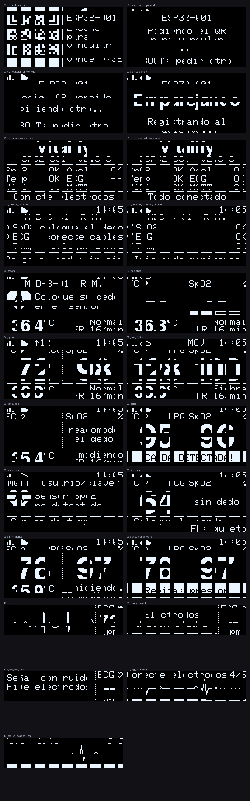

# Vitalify · IoT

Firmware del wearable (ESP32-S3 Zero) y configuración de la red por donde viajan sus datos hasta el backend.



## Cómo llegan los datos al backend

```
MAX30102 (FC, SpO2) ─┐
AD8232   (ECG)      ─┤   ESP32-S3    ──Wi-Fi──>   Mosquitto          ──MQTT──>   Backend Vitalify
DS18B20  (temp.)    ─┤   (tesis/)                (broker/, Docker              ReceptorMqtt          
MPU6050  (caídas,  ─┘                            en la laptop)                 → IRegistrarLectura
          FR)
```

| Aspecto | Valor |
|---|---|
| Tópico | `device/ESP32-001/telemetria` |
| QoS | 1: el ESP32 guarda cada lectura hasta que el broker confirma (PUBACK) |
| Frecuencia | Una lectura cada 10 s, y otra al instante si se detecta una caída |
| Formato | JSON de `Backend/docs/contrato-telemetria.md` |
| Estado del wearable | `device/ESP32-001/estado` = `online` / `offline` (retenido; `offline` lo publica el broker si el ESP32 desaparece) |
| Comandos del backend | `device/ESP32-001/comandos`: QR para vincular, `emparejando`, `vinculado` (cama e iniciales), `desvinculado` (ver *Vinculación por QR*) |
| Solicitudes | `device/ESP32-001/solicitudes`: el wearable pide un QR nuevo con `{"accion":"solicitar-qr"}` |

```json
{"dispositivo":"ESP32-001","ts":"2026-09-30T14:05:10.250Z","seq":18234,"fc":82,"fr":16,"spo2":97,"temp":36.8,"caida":false}
```

- `ts` es el instante de la medición en UTC (NTP), con milisegundos. Una lectura tomada antes de tener hora recibe su hora real al sincronizar.
- Lo que el sensor no midió se omite: sin dedo no van `fc` ni `spo2` (salvo que la FC venga del ECG), sin sonda no va `temp`, y sin el paciente quieto no va `fr`. Sin paciente conectado no se envía nada, y tampoco si el wearable no está vinculado a un paciente.
- La **FR** sale del MPU6050: el wearable va sujeto sobre el tórax o el abdomen y la respiración lo inclina unos grados (ver *Algoritmos*).
- Este hardware no mide `pas`, `pad` ni `bateria`. El backend calcula NEWS2 y MEWS con FC, FR, SpO2 y temperatura y marca el puntaje como parcial; la enfermera completa presión, conciencia y oxígeno con `POST /api/v1/pacientes/{id}/observaciones` (`Backend/docs/motor-clinico.md`).
- Se verificó con el código del backend: los JSON del firmware pasan por `MensajeTelemetria.Interpretar` y `EvaluadorSignos` sin errores.

## Estructura

```
tesis_V01/
├── tesis/               firmware (sketch de Arduino)
│   ├── tesis.ino        arranque y loop: sensores → algoritmos → pantallas y telemetría
│   ├── config.h         dispositivo, broker, tiempos, pines y calibración
│   ├── secretos.h       redes Wi-Fi, clave MQTT y broker de producción (no se versiona; plantilla: secretos.example.h)
│   ├── red.*            Wi-Fi, NTP, MQTT (TLS en producción), comandos del backend y búfer offline (tarea propia en el núcleo 0)
│   ├── raices_tls.h     raíces de Let's Encrypt (ISRG Root X1 y X2) para el broker de producción
│   ├── sensores.*       MAX30102, MPU6050 (o ADXL345), DS18B20 y AD8232
│   ├── ppg.*  ecg.*  caidas.*  respiracion.*  filtros.h    algoritmos (C++ puro, probados en el computador)
│   ├── vinculacion.*    comandos del backend, estado de la vinculación y QR (C++ puro, probado)
│   ├── qrcodegen.*      generador de QR de Nayuki (MIT, v1.8.0)
│   ├── telemetria.*     lectura, JSON del contrato y búfer
│   ├── pantallas.*      diseño de las dos OLED
│   └── pruebas/         pruebas de los algoritmos y vista previa de las pantallas
├── broker/              Mosquitto: usuarios, permisos por tópico y docker-compose
└── libraries/           librerías de Arduino que usa el firmware
```

## Puesta en marcha

### 1. Broker (en la laptop)

```bash
cd broker
cp .env.example .env      # solo la primera vez; ya existe uno con claves generadas
docker compose up -d
./escuchar.sh             # muestra en vivo lo que publican los wearables
```

Sin Terminal: en **Docker Desktop → Containers → vitalify-broker → vitalify-monitor → Logs** aparece cada JSON que llega. El log del contenedor `mosquitto` solo registra conexiones, nunca el contenido de los mensajes.

- La laptop y el ESP32 deben estar en la **misma red Wi-Fi**.
- El ESP32 encuentra el broker por el nombre mDNS de la laptop (`MacBook-Air-de-Mayck.local`, en `config.h`), así que no importa si el DHCP le cambia la IP. Si una red bloquea mDNS, pon la IP de la laptop en esa red en `secretos.h`.
- No hay acceso anónimo: el backend entra como `vitalify-backend` y cada wearable con su código como usuario. El ACL solo deja a cada wearable publicar en sus propios tópicos.

### 2. Registrar el sensor en el backend

El código `ESP32-001` debe existir (`POST /api/v1/dispositivos`, o `Seed__DatosDemo=true` en Development). Al conectarse, el backend le manda su QR y la OLED lo muestra: la enfermera lo escanea con la app y registra al paciente (ver *Vinculación por QR*). Mientras no esté vinculado, el wearable no envía lecturas.

Si actualizaste desde una versión anterior, **reinicia el broker** (`docker compose restart` en `broker/`): el ACL ahora permite las solicitudes de QR.

### 3. Firmware

Arduino IDE 2:

1. **Preferencias → Ubicación del sketchbook:** esta carpeta (`tesis_V01`), para que use `libraries/`.
2. **Placa:** *ESP32S3 Dev Module* (core *esp32* de Espressif 3.3.x), **USB CDC On Boot: Enabled**.
3. Revisa `CODIGO_DISPOSITIVO` y `MQTT_BROKER_POR_DEFECTO` en `config.h`, y tus redes en `secretos.h`. Para el servidor de producción, ver [Producción](#producción-servidor-con-tls).
4. Compila y sube `tesis/tesis.ino`.

En una Mac con Apple Silicon, el Arduino IDE usa un `ctags` compilado para Intel: sin Rosetta la compilación falla con *bad CPU type in executable*. Se instala con `softwareupdate --install-rosetta --agree-to-license`.

Con `arduino-cli`, desde esta carpeta:

```bash
arduino-cli compile --fqbn esp32:esp32:esp32s3:CDCOnBoot=cdc --libraries libraries tesis
arduino-cli upload  --fqbn esp32:esp32:esp32s3:CDCOnBoot=cdc -p /dev/cu.usbmodem* tesis
```

Con un **ESP32 DevKit** (ESP32 clásico, USB por CH340), la placa es *ESP32 Dev Module* y `config.h` toma sus pines solo:

```bash
arduino-cli compile --fqbn esp32:esp32:esp32 --libraries libraries tesis
arduino-cli upload  --fqbn esp32:esp32:esp32:UploadSpeed=460800 -p /dev/cu.usbserial-* tesis
```

### 4. Verificar

Monitor serie a 115200 baudios:

```
[red] Wi-Fi conectado a "MiRedCasa" | IP 192.168.1.23 | -58 dBm
[red] Hora NTP sincronizada: 2026-09-30T14:05:03.120Z (0 lecturas del bufer ya tienen hora)
[red] Broker MacBook-Air-de-Mayck.local -> 192.168.1.7
[red] MQTT conectado a 192.168.1.7:1883
[cmd] vinculado: cama MED-B-01, R.M.
[mqtt] device/ESP32-001/telemetria {"dispositivo":"ESP32-001","ts":"2026-09-30T14:05:10.250Z","seq":0,...}
MONITOREO (vinculado) | FC 72 (PPG) | SpO2 98 | FR 16 | dedo SI IR 52341 PI 1.20% | T 36.8 C | reposo | ECG sin electrodos | Wi-Fi MiRedCasa -58 dBm | MQTT OK | pendientes 0, enviadas 12
```

La tecla `p` en el monitor activa el trazado del ECG para el Serial Plotter. En la laptop, `broker/escuchar.sh` muestra los mismos mensajes que recibirá el backend.

## Conexiones (ESP32-S3 Zero)

| Módulo | Pines | Notas |
|---|---|---|
| MAX30102, MPU6050, OLED 128x64 | SDA → GPIO5, SCL → GPIO6 | Bus I2C 0 a 400 kHz (0x57, 0x68, 0x3C) |
| OLED 128x32 (ECG) | SDA → GPIO7, SCL → GPIO8 | Bus I2C 1 (0x3C) |
| DS18B20 | Datos → GPIO4 | Resistencia de 4,7 kΩ entre datos y 3V3 |
| AD8232 | OUTPUT → GPIO1, LO− → GPIO2, LO+ → GPIO3 | SDN al aire o a 3V3. **SDN a GND apaga el AD8232** |

### ESP32 DevKit (ESP32 clásico)

| Módulo | Pines | Notas |
|---|---|---|
| MAX30102, MPU6050, OLED 128x64 | SDA → GPIO26, SCL → GPIO33 | Bus I2C 0 a 400 kHz (0x57, 0x68, 0x3C). Los GPIO 6 a 11 son de la flash: no se usan |
| OLED 128x32 (ECG) | SDA → GPIO13 (D13), SCL → GPIO14 (D14) | Bus I2C 1. También es 0x3C: en el bus 0 chocaría con la OLED principal. **No usar D12** (está entre D14 y D13): GPIO12 en alto al reiniciar pone la flash a 1,8 V y el ESP32 no arranca. **Ni D2**: el LED azul de la placa mantiene la línea en bajo y la OLED no responde |
| DS18B20 | Datos → GPIO25 | Resistencia de 4,7 kΩ entre datos y 3V3 |
| AD8232 | OUTPUT → GPIO34, LO− → GPIO35, LO+ → GPIO32 | GPIO34 es ADC1 (funciona con el Wi-Fi encendido). 34 y 35 son solo entrada y no tienen pull-up interna: con una de 10 kΩ de GPIO35 a 3V3, un cable de LO− suelto se ve como "electrodos desconectados" en vez de ruido |
| LED verde | GPIO27 (D27) → resistencia de 220–330 Ω → ánodo; cátodo → GND | Encendido: todo funciona (ver *Pantallas*) |

**MPU6050** (módulo GY-521): VCC a 3V3, AD0 a GND o al aire (dirección 0x68; con AD0 a 3V3, 0x69, también funciona). Si no lo encuentra, el firmware usa un ADXL345 en 0x53 (la protoboard anterior). Para medir la FR, **el wearable va sujeto con la correa sobre el tórax o el abdomen**: en la mano o sobre la mesa no hay respiración que medir.

Todos los módulos a 3V3 y GND del mismo riel. El Wi-Fi transmite a 11 dBm (`WIFI_POTENCIA_TX`) para no provocar caídas de tensión en ese riel.

## Pantallas

Cada OLED tiene su función: la principal muestra el chequeo y los signos, y la delgada, la verificación y el ECG. Los números entre paréntesis son las vistas de `pantallas_oled.png`.

| Momento | OLED principal (128x64) | OLED del ECG (128x32) | LED verde |
|---|---|---|---|
| Arranque | Chequeo de SpO2, Acel, Temp, ECG, Wi-Fi y MQTT (`01a`, `01b`) | Verificación animada: qué falta, `n/6`, latido y barra de progreso (`12`, `13`) | Se enciende cuando todo responde |
| Sin vincular | El QR para la app de la enfermera, cuánto le queda y el código del sensor (`00a`); "Pidiendo el QR" (`00b`), "Código QR vencido" (`00c`) o "Emparejando" mientras registra al paciente (`00d`) | ECG | Encendido si el equipo está bien |
| Espera del paciente | "Conecte al paciente" con ✓, ○ o ✗ por sensor (`01c`, `01d`) | ECG; sin electrodos, "Electrodos desconectados" (`11`) | Encendido si el equipo está bien |
| Monitoreo | Signos: FC, SpO2, temperatura y alerta de caída (`02` a `09`) | ECG en barrido con la FC del ECG (`10`); con mala señal, "Señal con ruido" (`11b`) | Encendido si el equipo está bien |

**Arranque.** La pantalla de chequeo muestra SpO2, Acel, Temp, ECG, Wi-Fi y MQTT. En el ECG: `NO` = el módulo AD8232 no responde, `--` = responde pero los electrodos no están conectados, `OK` = electrodos conectados (el AD8232 solo los detecta sobre la piel). **No sigue mientras algún sensor diga NO o el ECG diga `--`** (se reintenta solo: puedes conectarlos en caliente); con todo OK espera la conexión al broker hasta 25 s y muestra "Todo conectado". El botón **BOOT** de la placa sigue igual aunque falte algo.

**Sesión de monitoreo** (`tesis/sesion.h`). Al encender, tras el chequeo de arranque, el equipo queda en **espera del paciente**: la pantalla "Conecte al paciente" marca cada sensor con ✓ (en el paciente), ○ (falta colocarlo) o ✗ (no instalado), y **no se envía nada al backend** (tampoco caídas: mover la placa sin paciente no es una caída). **Poner el dedo en el oxímetro (1 s) inicia el monitoreo**; desde ahí cada sensor se usa y se envía apenas se conecta (los electrodos o la sonda pueden ponerse después). La sesión termina tras 60 s sin dedo, sin electrodos y sin sonda en la piel. Si el oxímetro no está instalado, inicia con los electrodos o la sonda.

**OLED principal (128x64).** Las 16 filas de arriba (amarillas en las OLED bicolor) son el encabezado:

| Elemento | Significado |
|---|---|
| Barras | Señal Wi-Fi. Animadas: buscando red |
| Nube llena | Conectado al broker. Vacía parpadeando: intentando. Con `!`: usuario o clave MQTT rechazados |
| `↑12` | Lecturas guardadas esperando envío |
| `14:05` | Hora local (NTP). `--:--`: todavía sin hora |
| `FC ♥  ECG/PPG` | El corazón late con cada latido; `ECG` o `PPG` indica de dónde sale la FC |
| Barra bajo SpO2 | Progreso de la medición (4 latidos) |
| `MOV` | El acelerómetro detecta movimiento |
| Fila inferior | A la izquierda, la temperatura; a la derecha, su rango NEWS2 (Hipotermia, Baja, Normal, Fiebre, Fiebre alta) o `midiendo` mientras se estabiliza, y debajo la **FR** (`FR 16/min`; `FR midiendo` mientras junta 32 s quietos; `FR: quieto` si el paciente se mueve; `FR --` si no detecta respiración). `Coloque la sonda` si la sonda está al aire. Tras una caída: `¡CAIDA DETECTADA!` parpadeando durante 30 s; un aviso del backend (`Repita: presion`) se muestra igual durante 15 s |
| Encabezado del paciente | Ya vinculado, "Conecte al paciente" y la pantalla de espera muestran la cama y las iniciales (`MED-B-01  R.M.`): nunca el nombre |

Sin dedo ni electrodos muestra el código del dispositivo, la red y la indicación de colocar el dedo.

**OLED del ECG (128x32).** Durante el arranque muestra su propia verificación: arriba, lo que falta ahora (`Conecte electrodos`, `Buscando Wi-Fi`, `Conectando MQTT`…) y cuántos de los seis chequeos están listos; en medio, un latido animado que recorre la pantalla, y abajo, una barra de progreso. Al terminar dice `Todo listo 6/6` y pasa al ECG: trazo en barrido como en un monitor de cabecera (escala automática, ~3 s de trazo) y, a la derecha, la FC calculada del ECG con un corazón que late con cada QRS. El trazo es una línea fina y solo los QRS se dibujan de mínimo a máximo, así el ruido leve no lo engrosa. Sin electrodos parpadea "Electrodos desconectados". Si la señal es inservible (mucha interferencia de 60 Hz o el AD8232 saturado), en vez de dibujar el ruido muestra "Señal con ruido" y alterna "Fije electrodos" con "Revise el RL", y el ECG no informa FC. La OLED principal nunca muestra el ECG.

`tesis/pruebas/vista_previa.sh` regenera `pantallas_oled.png` con el código real del firmware.

**LED verde (GPIO27 en el DevKit).** Encendido fijo = todo funciona:

- responden el MAX30102, el MPU6050 (o el ADXL345), el DS18B20, el módulo AD8232 y las dos OLED;
- hay Wi-Fi y hora NTP;
- el broker MQTT está conectado, así que las lecturas llegan al backend.

Apagado = algo falla. Cada vez que cambia, el monitor serie dice qué falta (`LED verde apagado: falta OLED-ECG MQTT`). El LED no depende del paciente: sin dedo ni electrodos el equipo igual está bien y el LED sigue encendido.

## Algoritmos

- **PPG (FC y SpO2):** lectura del FIFO completo del MAX30102 a 100 Hz (el driver de SparkFun guardaba 4 muestras y perdía el resto); pasa-banda 0,5–5 Hz; latidos por función suma de pendientes con umbral adaptativo y refractario; FC con la mediana de los últimos RR y promedio de los cercanos a ella; SpO2 por razón de razones latido a latido con la curva de Maxim (`SPO2_A/B/C`). El dedo se detecta por salto sobre la luz ambiente y se libera tras 8 s sin pulso.
- **ECG:** muestreo a 250 Hz exactos en una tarea propia (antes quedaban huecos cada vez que se dibujaba la pantalla); pasa-altos 0,5 Hz, notch de 60 Hz y pasa-bajos 40 Hz para el trazo; detector QRS de Pan-Tompkins con rechazo de ondas T y búsqueda hacia atrás. Si los electrodos dan un ritmo confiable, la FC enviada sale del ECG. Calidad de la señal: mide la interferencia de la red (lo que quita el notch) y la fracción de muestras saturadas; con más de 200 conteos RMS o más del 2 % saturado la señal es ruidosa (se recupera bajo 140 y 0,5 %), no da FC y la OLED lo avisa. Las muestras saturadas no entran al trazo.
- **Caídas:** MPU6050 (o ADXL345) a ±16 g (antes ±2 g, que recortaba el golpe) y 100 Hz con FIFO; en el MPU6050 los giroscopios quedan apagados. Se confirma una caída con ingravidez → impacto → 2 s quieto → cambio de postura (nota AN-1023 de Analog Devices). Saltar, sentarse de golpe o acostarse no la disparan.
- **Frecuencia respiratoria (MPU6050, `respiracion.h`):** al respirar, el tórax inclina el wearable unos grados y la gravedad cambia de eje entre 5 y 50 mg. Se promedia a 10 Hz con un pasa-bajos de 1 Hz (quita el latido), se toma una ventana de 32 s sin tendencia, se proyecta sobre la dirección en que más oscila la gravedad (componente principal: no importa cómo esté puesto) y se busca el período con la autocorrelación (1,2 a 12 s: 50 a 5 rpm), eligiendo el primer pico alto tras un valle (un ciclo con dos jorobas no da el doble). Solo vale con el paciente quieto, con amplitud mínima y correlación ≥ 0,5; la FR es la mediana de las 3 últimas estimaciones y se recalcula cada 2 s. La primera FR llega a los 32 s de quietud; tras un movimiento, la anterior dura 10 s. En las pruebas: error ≤ 1 rpm de 6 a 45 rpm, con ritmo irregular (±30 %), inspiración corta, latido marcado y respiración de solo 1 a 3 mg; sobre la mesa o caminando no da FR.
- **Temperatura:** DS18B20 a 12 bits sin bloquear, mediana de 3 lecturas, descarta el valor de encendido (85 °C). El DS18B20 mide la superficie donde está: al aire marca el ambiente y en la mano ~32 °C. Por eso solo se informa con la sonda sobre la piel (≥ `TEMP_MIN_CONTACTO`, 32 °C). Para no esperar los ~5 min que tarda la sonda en llegar a la temperatura del cuerpo, usa el **método predictivo** de los termómetros clínicos electrónicos: ajusta por mínimos cuadrados la curva exponencial de calentamiento y da su valor final cuando las predicciones coinciden (en las pruebas: la mitad del tiempo, con error ≤ 0,2 °C). Después lo confirma con la medición directa (menos de 0,2 °C de variación en 60 s). Se clasifica con las bandas de NEWS2 y admite una corrección calibrada contra un termómetro clínico (`TEMP_CORRECCION_C`). Ya no se envía la temperatura interna del MAX30102 como si fuera corporal.

Pruebas en el computador (sin hardware):

```bash
tesis/pruebas/ejecutar.sh      # FC 40–200 lpm, SpO2, ruido, dícrota, onda T, caídas, FR, JSON, búfer, comandos y QR
```

## Vinculación por QR

El wearable se asigna a un paciente escaneando el QR de su OLED con la app de enfermería (`Backend/docs/vinculacion-qr.md`). El firmware sigue los comandos que publica el backend en `device/ESP32-001/comandos` (`tesis/vinculacion.h`):

| Comando | Pantalla | Telemetría |
|---|---|---|
| `mostrar-qr` (retenido) | El QR (`VTF1:ESP32-001:K7P3QX9M`) y cuánto le queda | No envía y descarta lo guardado |
| `emparejando` | "Emparejando": la enfermera está registrando al paciente | No envía |
| `vinculado` (retenido) | El flujo normal, con la cama y las iniciales | Envía cada 10 s y al instante si hay una caída |
| `desvinculado` (retenido) | Pide el QR nuevo (llega enseguida) | No envía y descarta lo guardado (era del paciente anterior) |
| `repetir-medicion` | Aviso de 15 s en la fila inferior | Sin cambio |

- Al conectarse, se suscribe a sus comandos antes de publicar `online`: el comando retenido le dice enseguida si sigue vinculado. Hasta recibirlo no vacía el búfer.
- Recién encendido y sin broker, mide y guarda como siempre; si al conectarse resulta que no estaba vinculado, descarta esas lecturas.
- Pide un QR nuevo (`{"accion":"solicitar-qr"}` en `device/ESP32-001/solicitudes`) si al conectarse no llega ningún comando en 5 s, si el QR venció o si se pulsa **BOOT** en la pantalla del QR (como máximo uno cada 10 s). El backend, además, renueva solo los QR vencidos.
- **El QR:** generador de Nayuki (`qrcodegen.c`, MIT), la versión más chica en la que entra el texto (la 2, de 25x25, con el código `ESP32-001`; hasta la 3 con códigos de 32 caracteres), corrección M o mayor, oscuro sobre un cuadro claro de 64x64 y a 2 px por módulo. Va a 4 px del borde de arriba: en las OLED bicolor, la franja sin píxeles entre la zona amarilla y la azul (filas 15 y 16) cortaba sus patrones de posición y no se leía; así solo engrosa una fila oscura. Se comprobó leyendo la imagen de `vista_previa` con un lector de QR (zxing), con y sin la franja simulada.
- La librería `QRCode` de ricmoo no se usa: su `qrcode.h` choca con el del core ESP32 3.x. El core también trae un `qrcodegen` dentro de `libespressif__qrcode.a`, pero como el firmware no llama a `esp_qrcode_*`, el enlazador usa el del sketch.

## Conectividad

- La red corre en una tarea del núcleo 0: una red caída o un broker apagado ya no congelan sensores ni pantallas.
- Wi-Fi: escanea, se une a la red conocida con mejor señal y, si se cae, vuelve a buscar (espera creciente hasta 30 s). Reconoce errores de clave y los muestra.
- MQTT: cliente nativo de ESP-IDF con QoS 1, reconexión automática y *last will*. Si la laptop cambió de IP, vuelve a resolver su nombre.
- Búfer: hasta 360 lecturas (1 h) sin red o sin broker; se envían en orden al volver (el backend acepta hasta 24 h de atraso y descarta duplicados por dispositivo + `ts`).

### Producción (servidor con TLS)

En producción, el wearable no habla con la laptop. Sale a Internet hacia el Mosquitto del servidor, que está junto a la API (`Backend/docs/despliegue.md`). Se activa en `secretos.h` (plantilla en `secretos.example.h`):

```cpp
#define MQTT_BROKER_TLS "vitalify-tesis.eastus2.cloudapp.azure.com"  // el DOMINIO del .env del servidor
#define MQTT_PUERTO_TLS 8883
// y, dentro de #ifdef MQTT_BROKER_TLS, MQTT_CLAVE = la clave del wearable en el passwd del servidor
```

Con eso:

- El wearable se conecta al **dominio** (no a una IP), por el **8883** con **TLS** (`MQTT_TRANSPORT_OVER_SSL`). Los brokers por red de `REDES_WIFI` dejan de usarse.
- Valida el certificado del servidor con las raíces de Let's Encrypt de `raices_tls.h`: ISRG Root X1 y X2.
  - El certificado lo renueva Caddy cada ~60 días, pero las raíces no cambian (X1 vence en 2035 y X2 en 2040), así que no hace falta volver a compilar.
  - La cadena actual (`YE2 → Root YE → X2 → X1`) valida con cualquiera de las dos.
- Espera la hora del NTP antes de conectarse (la OLED dice "esperando hora NTP"), porque el certificado tiene fechas y cada `ts` sale de ese reloj.
- La clave de producción es otra que la de `broker/.env`. Se crea en el servidor con `scripts/agregar-wearable-mqtt.sh CODIGO`.

Para volver a la laptop, comenta las dos líneas `#define`: se usa `MQTT_CLAVE` de desarrollo (la rama `#else`).

## Backend: receptor MQTT

El backend ya lee este broker (`Backend/src/Vitalify.Api/Entrada/Mqtt/ReceptorMqtt.cs`):

- Entra como `vitalify-backend` con **sesión persistente** y *client id* fijo, y se suscribe con **QoS 1** a `device/+/telemetria`, `device/+/estado` y `device/+/solicitudes`; publica los comandos en `device/+/comandos`. Lo que llegue mientras el backend está caído queda en el broker (hasta 1000 mensajes).
- Cada payload pasa por `MensajeTelemetria.Interpretar(payload, OrigenLectura.Mqtt)` y luego por `IRegistrarLectura`. El código del JSON debe coincidir con el del tópico.
- `online`/`offline` se ve como `conexionSensor` en `GET /api/v1/pacientes/monitoreados`.
- Configuración en el `.env` del backend: `Mqtt__Habilitado=true`, `Mqtt__Servidor=localhost`, `Mqtt__Usuario=vitalify-backend` y `Mqtt__Clave` = `MQTT_BACKEND_CLAVE` de `broker/.env`. Con el broker arriba, `/health` del backend muestra `mqtt: Healthy`.
- El backend prueba este contrato con los mismos JSON de `tesis/pruebas/pruebas.cpp` (`ContratoFirmwareTests`) y publicándolos en un Mosquitto real (`IotMqttTests`).

## Problemas frecuentes

| Qué muestra la OLED | Causa probable | Qué hacer |
|---|---|---|
| Barras animadas, "buscando Wi-Fi" | Ninguna red de `secretos.h` al alcance | Red de 2,4 GHz y SSID exacto (con mayúsculas y espacios) |
| "clave Wi-Fi?" | Contraseña incorrecta | Corregir `secretos.h` |
| "Pidiendo el QR" que no cambia | El backend no recibió la solicitud o no conoce el sensor | El sensor debe estar registrado en el backend y el broker reiniciado con el ACL nuevo (permite `solicitudes`); BOOT pide otro |
| El QR aparece pero la app no lo lee | Brillo o distancia | Acercar el celular a 10–15 cm y de frente. Si dice "vencido", BOOT pide otro |
| `FR: quieto` | El paciente se mueve o el wearable se desplazó | La FR vuelve a los 32 s de quietud |
| `FR --` | No hay oscilación respiratoria: el wearable no está sobre el tórax o está flojo | Ajustar la correa sobre el tórax o el abdomen |
| Nube vacía, "broker no encontrado" | Mosquitto apagado o laptop en otra red | `docker compose up -d`; misma red; si la red bloquea mDNS, IP en `secretos.h` |
| Nube con `!`, "MQTT: usuario/clave?" | La clave de `secretos.h` no coincide con `broker/.env` (o, en producción, con el `passwd` del servidor) | Igualarlas y reiniciar el broker; en producción, `scripts/agregar-wearable-mqtt.sh CODIGO` |
| "esperando hora NTP" (producción) | La red no deja salir al NTP; sin hora no se intenta TLS | Usar una red con Internet (el hotspot sirve) |
| "TLS: certificado?" (producción) | El certificado del servidor no validó: dominio mal escrito en `MQTT_BROKER_TLS` o una cadena que no termina en ISRG Root X1/X2 | Revisar el dominio; el monitor serie muestra los *flags* de mbedTLS. Desde la Mac: `openssl s_client -connect DOMINIO:8883 -servername DOMINIO` |
| `--:--` y `↑N` creciendo | Sin NTP (la red no tiene salida a internet) | Las lecturas se guardan y se envían al tener hora |
| "Electrodos desconectados" | LO+ o LO− en alto | Revisar electrodos y que SDN no esté a GND |
| "Sin sonda temp." | DS18B20 sin respuesta | Revisar la resistencia de 4,7 kΩ y GPIO4 |
| "Coloque la sonda" | La sonda está al aire o en la mano (< 32 °C) | Colocarla en la axila y esperar a que deje de decir `midiendo` |
| "Señal con ruido" en la OLED del ECG | El AD8232 se satura o entra mucha interferencia de 60 Hz: electrodos secos o mal pegados, falta el RL o se sostienen con los dedos. El monitor serie dice cuánto (`ECG: senal con ruido (red N RMS, saturada N%)`) | Electrodos nuevos con gel, sobre la piel limpia: RA (rojo) bajo la clavícula derecha, LA (amarillo) bajo la izquierda y RL (verde) en el abdomen, abajo a la derecha. Jack de 3,5 mm bien metido, quieto al medir y los cables lejos del cargador de la laptop |
| OLED del ECG apagada | No responde en el bus 1 (al arrancar, el monitor serie muestra `I2C bus 1 (SDA=13, SCL=14): ninguno`; si una línea está en bajo, antes dice cuál: `I2C bus 1: SCL en bajo en reposo`) | Revisar SDA/SCL de la OLED 128x32 (DevKit: D13 y D14) y su alimentación. Se reconecta sola en 5 s |
| Ambas OLED apagadas y el monitor serie repite `boot:0x33` e `invalid magic number` | GPIO12 está en alto al reiniciar (un cable en D12) y la flash queda a 1,8 V | Sacar ese cable de D12 (la OLED del ECG va en D13 y D14) y reiniciar con EN |
| LED verde apagado | Algo de la lista del LED falla | El monitor serie dice qué falta (`LED verde apagado: falta ...`). Si no dice nada y el LED no prende, revisar la polaridad y la resistencia |

## Limitaciones

- La SpO2 usa la curva genérica de Maxim. Para la tesis conviene calibrar `SPO2_A/B/C` contra un oxímetro de referencia. No es un dispositivo médico certificado.
- El DS18B20 mide la superficie donde está apoyado: en la piel marca menos que la temperatura central.
- El búfer está en RAM: si el ESP32 se reinicia, se pierde lo que no se había enviado.
- El firmware ocupaba el 88 % de la partición de la app en el DevKit (86 % en el S3); la FR y el QR suman unos 15 KB. Si se agregan funciones, elegir el esquema de particiones *Huge APP*.
- La FR se probó con señales sintéticas (inclinación del tórax, ruido del sensor, latido y movimiento). Para la tesis conviene validarla contra el conteo manual de 60 s de una enfermera, con el wearable en la posición en que se usará.
