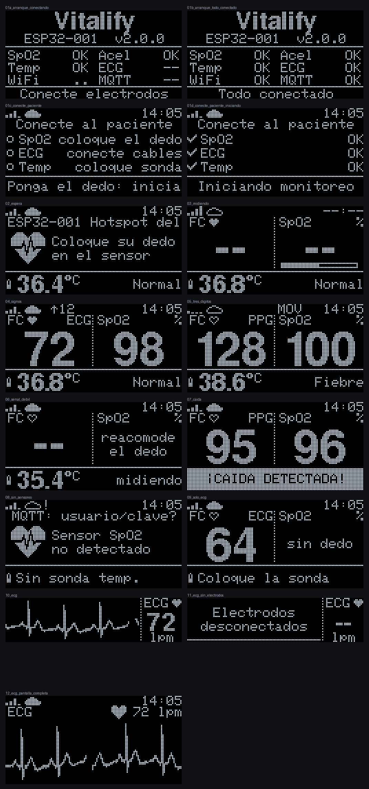

# Vitalify · IoT

Firmware del wearable (ESP32-S3 Zero) y configuración de la red por donde viajan sus datos hasta el backend.



## Cómo llegan los datos al backend

```
MAX30102 (FC, SpO2) ─┐
AD8232   (ECG)      ─┤   ESP32-S3    ──Wi-Fi──>   Mosquitto          ──MQTT──>   Backend Vitalify
DS18B20  (temp.)    ─┤   (tesis/)                (broker/, Docker              ReceptorMqtt          
ADXL345  (caídas)   ─┘                            en la laptop)                 → IRegistrarLectura
```

| Aspecto | Valor |
|---|---|
| Tópico | `device/ESP32-001/telemetria` |
| QoS | 1: el ESP32 guarda cada lectura hasta que el broker confirma (PUBACK) |
| Frecuencia | Una lectura cada 10 s, y otra al instante si se detecta una caída |
| Formato | JSON de `Backend/docs/contrato-telemetria.md` |
| Estado del wearable | `device/ESP32-001/estado` = `online` / `offline` (retenido; `offline` lo publica el broker si el ESP32 desaparece) |

```json
{"dispositivo":"ESP32-001","ts":"2026-09-30T14:05:10.250Z","seq":18234,"fc":82,"spo2":97,"temp":36.8,"caida":false}
```

- `ts` es el instante de la medición en UTC (NTP), con milisegundos. Una lectura tomada antes de tener hora recibe su hora real al sincronizar.
- Lo que el sensor no midió se omite: sin dedo no van `fc` ni `spo2` (salvo que la FC venga del ECG), sin sonda no va `temp`. Sin paciente conectado no se envía nada.
- Este hardware no mide `fr`, `pas`, `pad` ni `bateria`. El backend calcula NEWS2 y MEWS con FC, SpO2 y temperatura y marca el puntaje como parcial; la enfermera completa FR, presión, conciencia y oxígeno con `POST /api/v1/pacientes/{id}/observaciones` (`Backend/docs/motor-clinico.md`).
- Se verificó con el código del backend: los JSON del firmware pasan por `MensajeTelemetria.Interpretar` y `EvaluadorSignos` sin errores.

## Estructura

```
tesis_V01/
├── tesis/               firmware (sketch de Arduino)
│   ├── tesis.ino        arranque y loop: sensores → algoritmos → pantallas y telemetría
│   ├── config.h         dispositivo, broker, tiempos, pines y calibración
│   ├── secretos.h       redes Wi-Fi y clave MQTT (no se versiona; plantilla: secretos.example.h)
│   ├── red.*            Wi-Fi, NTP, MQTT y búfer offline (tarea propia en el núcleo 0)
│   ├── sensores.*       MAX30102, ADXL345, DS18B20 y AD8232
│   ├── ppg.*  ecg.*  caidas.*  filtros.h    algoritmos (C++ puro, probados en el computador)
│   ├── telemetria.*     lectura, JSON del contrato y búfer
│   ├── pantallas.*      diseño de las dos OLED
│   └── pruebas/         pruebas de los algoritmos y vista previa de las pantallas
├── broker/              Mosquitto: usuarios, permisos por tópico y docker-compose
└── libraries/           librerías de Arduino que usa el firmware
```

## Puesta en marcha

### 1. Broker (en la laptop)

```bash
cd broker
cp .env.example .env      # solo la primera vez; ya existe uno con claves generadas
docker compose up -d
./escuchar.sh             # muestra en vivo lo que publican los wearables
```

Sin Terminal: en **Docker Desktop → Containers → vitalify-broker → vitalify-monitor → Logs** aparece cada JSON que llega. El log del contenedor `mosquitto` solo registra conexiones, nunca el contenido de los mensajes.

- La laptop y el ESP32 deben estar en la **misma red Wi-Fi**.
- El ESP32 encuentra el broker por el nombre mDNS de la laptop (`MacBook-Air-de-Mayck.local`, en `config.h`), así que no importa si el DHCP le cambia la IP. Si una red bloquea mDNS, pon la IP de la laptop en esa red en `secretos.h`.
- No hay acceso anónimo: el backend entra como `vitalify-backend` y cada wearable con su código como usuario. El ACL solo deja a cada wearable publicar en sus propios tópicos.

### 2. Registrar el sensor en el backend

El código `ESP32-001` debe existir (`POST /api/v1/dispositivos`, o `Seed__DatosDemo=true` en Development) y estar vinculado a un paciente. Si no, el backend registra la incidencia `DispositivoDesconocido` o `DispositivoSinVincular` y no guarda la lectura.

### 3. Firmware

Arduino IDE 2:

1. **Preferencias → Ubicación del sketchbook:** esta carpeta (`tesis_V01`), para que use `libraries/`.
2. **Placa:** *ESP32S3 Dev Module* (core *esp32* de Espressif 3.3.x), **USB CDC On Boot: Enabled**.
3. Revisa `CODIGO_DISPOSITIVO` y `MQTT_BROKER_POR_DEFECTO` en `config.h`, y tus redes en `secretos.h`.
4. Compila y sube `tesis/tesis.ino`.

En una Mac con Apple Silicon, el Arduino IDE usa un `ctags` compilado para Intel: sin Rosetta la compilación falla con *bad CPU type in executable*. Se instala con `softwareupdate --install-rosetta --agree-to-license`.

Con `arduino-cli`, desde esta carpeta:

```bash
arduino-cli compile --fqbn esp32:esp32:esp32s3:CDCOnBoot=cdc --libraries libraries tesis
arduino-cli upload  --fqbn esp32:esp32:esp32s3:CDCOnBoot=cdc -p /dev/cu.usbmodem* tesis
```

### 4. Verificar

Monitor serie a 115200 baudios:

```
[red] Wi-Fi conectado a "MiRedCasa" | IP 192.168.1.23 | -58 dBm
[red] Hora NTP sincronizada: 2026-09-30T14:05:03.120Z (0 lecturas del bufer ya tienen hora)
[red] Broker MacBook-Air-de-Mayck.local -> 192.168.1.7
[red] MQTT conectado a 192.168.1.7:1883
[mqtt] device/ESP32-001/telemetria {"dispositivo":"ESP32-001","ts":"2026-09-30T14:05:10.250Z","seq":0,...}
FC 72 (PPG) | SpO2 98 | dedo SI IR 52341 PI 1.20% | T 36.8 C | reposo | ECG sin electrodos | Wi-Fi MiRedCasa -58 dBm | MQTT OK | pendientes 0, enviadas 12
```

La tecla `p` en el monitor activa el trazado del ECG para el Serial Plotter. En la laptop, `broker/escuchar.sh` muestra los mismos mensajes que recibirá el backend.

## Conexiones (ESP32-S3 Zero)

| Módulo | Pines | Notas |
|---|---|---|
| MAX30102, ADXL345, OLED 128x64 | SDA → GPIO5, SCL → GPIO6 | Bus I2C 0 a 400 kHz (0x57, 0x53, 0x3C) |
| OLED 128x32 (ECG, opcional) | SDA → GPIO7, SCL → GPIO8 | Bus I2C 1 (0x3C). Sin ella, el ECG se muestra en la OLED principal |
| DS18B20 | Datos → GPIO4 | Resistencia de 4,7 kΩ entre datos y 3V3 |
| AD8232 | OUTPUT → GPIO1, LO− → GPIO2, LO+ → GPIO3 | SDN al aire o a 3V3. **SDN a GND apaga el AD8232** |

Todos los módulos a 3V3 y GND del mismo riel. El Wi-Fi transmite a 11 dBm (`WIFI_POTENCIA_TX`) para no provocar caídas de tensión en ese riel.

## Pantallas

**Arranque.** La pantalla de chequeo muestra SpO2, Acel, Temp, ECG, Wi-Fi y MQTT. En el ECG: `NO` = el módulo AD8232 no responde, `--` = responde pero los electrodos no están conectados, `OK` = electrodos conectados (el AD8232 solo los detecta sobre la piel). **No sigue mientras algún sensor diga NO o el ECG diga `--`** (se reintenta solo: puedes conectarlos en caliente); con todo OK espera la conexión al broker hasta 25 s y muestra "Todo conectado". El botón **BOOT** de la placa sigue igual aunque falte algo.

**Sesión de monitoreo** (`tesis/sesion.h`). Al encender, tras el chequeo de arranque, el equipo queda en **espera del paciente**: la pantalla "Conecte al paciente" marca cada sensor con ✓ (en el paciente), ○ (falta colocarlo) o ✗ (no instalado), y **no se envía nada al backend** (tampoco caídas: mover la placa sin paciente no es una caída). **Poner el dedo en el oxímetro (1 s) inicia el monitoreo**; desde ahí cada sensor se usa y se envía apenas se conecta (los electrodos o la sonda pueden ponerse después). La sesión termina tras 60 s sin dedo, sin electrodos y sin sonda en la piel. Si el oxímetro no está instalado, inicia con los electrodos o la sonda.

**OLED principal (128x64).** Las 16 filas de arriba (amarillas en las OLED bicolor) son el encabezado:

| Elemento | Significado |
|---|---|
| Barras | Señal Wi-Fi. Animadas: buscando red |
| Nube llena | Conectado al broker. Vacía parpadeando: intentando. Con `!`: usuario o clave MQTT rechazados |
| `↑12` | Lecturas guardadas esperando envío |
| `14:05` | Hora local (NTP). `--:--`: todavía sin hora |
| `FC ♥  ECG/PPG` | El corazón late con cada latido; `ECG` o `PPG` indica de dónde sale la FC |
| Barra bajo SpO2 | Progreso de la medición (4 latidos) |
| `MOV` | El acelerómetro detecta movimiento |
| Fila inferior | Temperatura y su rango NEWS2 (Hipotermia, Baja, Normal, Fiebre, Fiebre alta); `midiendo` mientras se estabiliza; `Coloque la sonda` si está al aire. Tras una caída: `¡CAIDA DETECTADA!` parpadeando durante 30 s |

Sin dedo ni electrodos muestra el código del dispositivo, la red y la indicación de colocar el dedo.

**ECG.** Trazo en barrido como en un monitor de cabecera (escala automática) y la FC calculada del ECG.
- **Con una sola OLED:** la pantalla alterna entre los signos (10 s) y el ECG a pantalla completa (6 s, ~4 s de trazo). Solo cambia al ECG si los electrodos están puestos y nunca tapa una alerta de caída. Los tiempos están en `config.h` (`PANTALLA_SIGNOS_MS`, `PANTALLA_ECG_MS`).
- **Con la OLED 128x32 conectada:** el ECG queda fijo en ella (~3 s de trazo) y la principal muestra solo los signos.

`tesis/pruebas/vista_previa.sh` regenera `pantallas_oled.png` con el código real del firmware.

## Algoritmos

- **PPG (FC y SpO2):** lectura del FIFO completo del MAX30102 a 100 Hz (el driver de SparkFun guardaba 4 muestras y perdía el resto); pasa-banda 0,5–5 Hz; latidos por función suma de pendientes con umbral adaptativo y refractario; FC con la mediana de los últimos RR y promedio de los cercanos a ella; SpO2 por razón de razones latido a latido con la curva de Maxim (`SPO2_A/B/C`). El dedo se detecta por salto sobre la luz ambiente y se libera tras 8 s sin pulso.
- **ECG:** muestreo a 250 Hz exactos en una tarea propia (antes quedaban huecos cada vez que se dibujaba la pantalla); pasa-altos 0,5 Hz, notch de 60 Hz y pasa-bajos 40 Hz para el trazo; detector QRS de Pan-Tompkins con rechazo de ondas T y búsqueda hacia atrás. Si los electrodos dan un ritmo confiable, la FC enviada sale del ECG.
- **Caídas:** ADXL345 a ±16 g (antes ±2 g, que recortaba el golpe) y 100 Hz con FIFO. Se confirma una caída con ingravidez → impacto → 2 s quieto → cambio de postura (nota AN-1023 de Analog Devices). Saltar, sentarse de golpe o acostarse no la disparan.
- **Temperatura:** DS18B20 a 12 bits sin bloquear, mediana de 3 lecturas, descarta el valor de encendido (85 °C). El DS18B20 mide la superficie donde está: al aire marca el ambiente y en la mano ~32 °C. Por eso solo se informa con la sonda sobre la piel (≥ `TEMP_MIN_CONTACTO`, 32 °C). Para no esperar los ~5 min que tarda la sonda en llegar a la temperatura del cuerpo, usa el **método predictivo** de los termómetros clínicos electrónicos: ajusta por mínimos cuadrados la curva exponencial de calentamiento y da su valor final cuando las predicciones coinciden (en las pruebas: la mitad del tiempo, con error ≤ 0,2 °C). Después lo confirma con la medición directa (menos de 0,2 °C de variación en 60 s). Se clasifica con las bandas de NEWS2 y admite una corrección calibrada contra un termómetro clínico (`TEMP_CORRECCION_C`). Ya no se envía la temperatura interna del MAX30102 como si fuera corporal.

Pruebas en el computador (sin hardware):

```bash
tesis/pruebas/ejecutar.sh      # FC 40–200 lpm, SpO2, ruido, dícrota, onda T, caídas, JSON y búfer
```

## Conectividad

- La red corre en una tarea del núcleo 0: una red caída o un broker apagado ya no congelan sensores ni pantallas.
- Wi-Fi: escanea, se une a la red conocida con mejor señal y, si se cae, vuelve a buscar (espera creciente hasta 30 s). Reconoce errores de clave y los muestra.
- MQTT: cliente nativo de ESP-IDF con QoS 1, reconexión automática y *last will*. Si la laptop cambió de IP, vuelve a resolver su nombre.
- Búfer: hasta 360 lecturas (1 h) sin red o sin broker; se envían en orden al volver (el backend acepta hasta 24 h de atraso y descarta duplicados por dispositivo + `ts`).

## Backend: receptor MQTT

El backend ya lee este broker (`Backend/src/Vitalify.Api/Entrada/Mqtt/ReceptorMqtt.cs`):

- Entra como `vitalify-backend` con **sesión persistente** y *client id* fijo, y se suscribe con **QoS 1** a `device/+/telemetria` y `device/+/estado`. Lo que llegue mientras el backend está caído queda en el broker (hasta 1000 mensajes).
- Cada payload pasa por `MensajeTelemetria.Interpretar(payload, OrigenLectura.Mqtt)` y luego por `IRegistrarLectura`. El código del JSON debe coincidir con el del tópico.
- `online`/`offline` se ve como `conexionSensor` en `GET /api/v1/pacientes/monitoreados`.
- Configuración en el `.env` del backend: `Mqtt__Habilitado=true`, `Mqtt__Servidor=localhost`, `Mqtt__Usuario=vitalify-backend` y `Mqtt__Clave` = `MQTT_BACKEND_CLAVE` de `broker/.env`. Con el broker arriba, `/health` del backend muestra `mqtt: Healthy`.
- El backend prueba este contrato con los mismos JSON de `tesis/pruebas/pruebas.cpp` (`ContratoFirmwareTests`) y publicándolos en un Mosquitto real (`IotMqttTests`).

## Problemas frecuentes

| Qué muestra la OLED | Causa probable | Qué hacer |
|---|---|---|
| Barras animadas, "buscando Wi-Fi" | Ninguna red de `secretos.h` al alcance | Red de 2,4 GHz y SSID exacto (con mayúsculas y espacios) |
| "clave Wi-Fi?" | Contraseña incorrecta | Corregir `secretos.h` |
| Nube vacía, "broker no encontrado" | Mosquitto apagado o laptop en otra red | `docker compose up -d`; misma red; si la red bloquea mDNS, IP en `secretos.h` |
| Nube con `!`, "MQTT: usuario/clave?" | La clave de `secretos.h` no coincide con `broker/.env` | Igualarlas y reiniciar el broker |
| `--:--` y `↑N` creciendo | Sin NTP (la red no tiene salida a internet) | Las lecturas se guardan y se envían al tener hora |
| "Electrodos desconectados" | LO+ o LO− en alto | Revisar electrodos y que SDN no esté a GND |
| "Sin sonda temp." | DS18B20 sin respuesta | Revisar la resistencia de 4,7 kΩ y GPIO4 |
| "Coloque la sonda" | La sonda está al aire o en la mano (< 32 °C) | Colocarla en la axila y esperar a que deje de decir `midiendo` |

## Limitaciones

- La SpO2 usa la curva genérica de Maxim. Para la tesis conviene calibrar `SPO2_A/B/C` contra un oxímetro de referencia. No es un dispositivo médico certificado.
- El DS18B20 mide la superficie donde está apoyado: en la piel marca menos que la temperatura central.
- El búfer está en RAM: si el ESP32 se reinicia, se pierde lo que no se había enviado.
- El firmware ocupa el 86 % de la partición de la app. Si se agregan funciones, elegir el esquema de particiones *Huge APP*.
